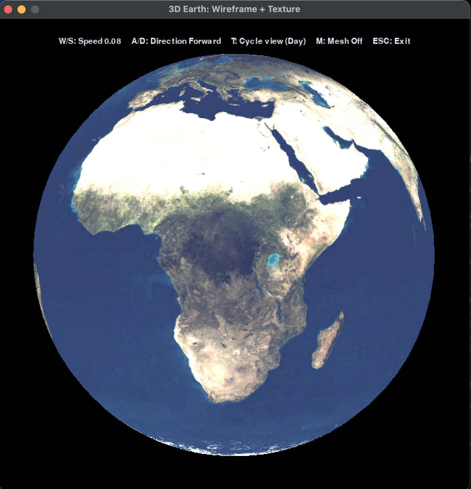

# 🌍 3D Animated Earth and Moon

A lightweight, interactive 3D visualization of Earth and the Moon, built with Python. Experience a smooth, hardware-accelerated rotation of our home planet with interactive controls.



## ✨ Features

*   🚀 **High-Performance Rendering**: Uses **PyOpenGL** for smooth, hardware-accelerated 3D graphics.
*   🎮 **Real-Time Interactivity**: Fully interactive controls to adjust rotation speed and direction, on the fly.
*   🗺️ **Image Wraps**: Choose Earth day, Earth night or the Moon, on the fly.  
*   🕸️ **Wireframe Overlay**: Add or remove a blue wireframe mesh overlay for a "tech", "digital" aesthetic, or none for a clearer view.

## 🚀 Getting Started

You’ll need Python 3. The app uses the texture images included in this project.

1. Open a terminal in this project folder.
2. Install the required packages:

   ```bash
   python3 -m pip install pygame PyOpenGL numpy Pillow
   ```

3. Start the viewer:

   ```bash
   python3 earth.py
   ```

The app loads `earth_texture.jpg`, `earth_lights.png`, and `moon_texture.jpg` from this project folder.

## 🎮 Controls

| Key       | Action                                                   |
| --------- | -------------------------------------------------------- |
| **W / S** | Adjust rotation speed                                    |
| **A / D** | Rotate (Backward / Forward)                              |
| **T**     | Cycle views (Day $\rightarrow$ Night $\rightarrow$ Moon) |
| **M**     | Toggle wireframe mesh                                    |
| **ESC**   | Exit                                                     |

The top of the window shows the current speed, direction, view, and mesh setting.

